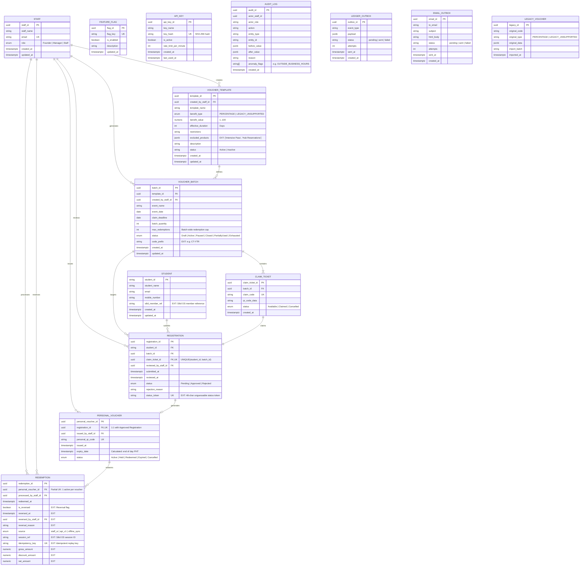

# SILID Voucher Service — Entity Relationship Diagram (ERD)

This diagram documents the complete relational model of the SILID Voucher Service, highlighting both the core authoritative entities from `reference/SiliD_Complete_System_Diagrams.pdf` and the integration extensions detailed in `Database/EXTENSIONS.md`.

---

## Core Invariants & Rules Enforced in Database:
1. `UNIQUE(student_id, batch_id)` on `registration`: Prevents a student from claiming more than 1 ticket per event.
2. `Registration.claimTicketId` is unique and checked via trigger `trg_check_ticket_batch` to ensure `claim_ticket.batch_id == registration.batch_id`.
3. Only an `Approved` registration may have a personal voucher (enforced in application logic & foreign key relationship).
4. Partial unique index on `redemption(personal_voucher_id) WHERE NOT is_reversed`: Enforces single-use while allowing reversals to restore voucher to Active.
5. Atomic redemption with dual locking: `voucher_batch FOR UPDATE` then `personal_voucher FOR UPDATE` prevents concurrent cap exceedance across vouchers.
